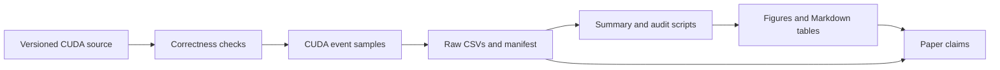

# Research guide

This is the GitHub entry point for the study. The [paper](paper.md) contains
the claims and discussion. The [preserved T4 run](../results/runs/2026-08-23_tesla-t4_ca87722/SOURCE.md)
contains the measured evidence. CPU analysis can be regenerated without CUDA;
new kernel timings require an NVIDIA environment.

| Read this | For |
|---|---|
| [Paper](paper.md) | Research questions, methods, measured findings, and discussion |
| [Methodology](methodology.md) | Workloads, controls, baselines, and timing protocol |
| [Results](results.md) | Detailed numerical interpretation |
| [Kernel evolution](kernel_evolution.md) | Historical source revisions and ablation design |
| [Limitations](limitations.md) | Validity boundaries and next experiments |
| [Reproducibility](reproducibility.md) | Exact CPU and GPU procedures |
| [Colab guide](colab_experiments.md) | Full NVIDIA experiment workflow |

## From measurement to claim



The [run source record](../results/runs/2026-08-23_tesla-t4_ca87722/SOURCE.md)
documents the archive import and source revision. The run's `artifacts/`
directory is preserved unchanged; regenerated outputs belong in a fresh
directory. `schema_audit.json` checks structure and `figure_provenance.json`
checks figure input hashes. Neither audit repeats GPU measurements.

## Claim to evidence map

| Claim | Primary evidence |
|---|---|
| Softmax numerical agreement | [Correctness cases](../results/runs/2026-08-23_tesla-t4_ca87722/artifacts/correctness/correctness_results.csv) |
| Historical kernel speedups | [Historical samples](../results/runs/2026-08-23_tesla-t4_ca87722/artifacts/benchmarks/raw/historical_raw.csv) |
| Launch size preference | [Launch samples](../results/runs/2026-08-23_tesla-t4_ca87722/artifacts/benchmarks/raw/launch_configuration_raw.csv) |
| Framework softmax comparison | [Softmax samples](../results/runs/2026-08-23_tesla-t4_ca87722/artifacts/benchmarks/raw/softmax_raw.csv) |
| Attention translation | [Attention samples](../results/runs/2026-08-23_tesla-t4_ca87722/artifacts/attention/attention_raw.csv) |
| Profiler observations | [PyTorch events](../results/runs/2026-08-23_tesla-t4_ca87722/artifacts/profiler/pytorch_profiler_events.csv) and [Nsight export](../results/runs/2026-08-23_tesla-t4_ca87722/artifacts/profiler/nsight/ncu_raw_export.csv) |
| Hardware and software | [Environment](../results/runs/2026-08-23_tesla-t4_ca87722/artifacts/environment/environment.json) and [manifest](../results/runs/2026-08-23_tesla-t4_ca87722/artifacts/experiment_manifest.json) |

## Rebuild the published analysis

After installing `python -m pip install -e ".[dev]"` from the repository root:

```bash
./scripts/verify_cpu_reproducibility.sh
./scripts/reproduce_published_results.sh
```

The second command prints a new temporary directory containing validated
audits, a speedup comparison CSV, figures, and Markdown tables. Pass an unused
directory as its argument to retain output at a chosen path. See the
[reproducibility guide](reproducibility.md) for GPU remeasurement.
